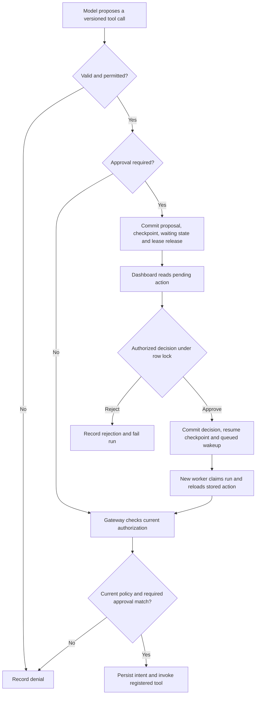

# Human approval workflow

Validate arguments and apply schema defaults before freezing the action. Compute SHA-256 over canonical JSON (RFC 8785) containing tenant ID, run ID, step ID, immutable tool version ID and normalized arguments. Restrict inputs to values supported by the canonicalizer. Persist those exact arguments and the digest. Render escaped structured values from the proposal alongside the tool, risk and expiry in the dashboard.

A human with the tenant approver role submits the observed digest and decision. In one transaction recheck membership, run state, deadline, proposal expiry and digest. A duplicate identical decision returns its receipt. A contradictory decision or altered digest conflicts. An expired pending proposal ends the run with `approval_expired` unless the run deadline takes precedence. Cancellation invalidates pending decisions.

At dispatch the gateway reloads the stored action, checks the active tool and permissions, recomputes the digest, verifies any required approval and records intent against the unique step. A changed argument requires a new proposal. A retry of the same authorized operation follows its idempotency policy. A model string, message header or worker-provided flag cannot grant approval.
