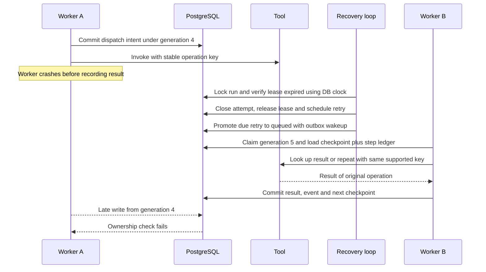

# Crash recovery

Renew active leases before one third of the configured lease duration elapses. Worker liveness and run ownership are separate records. A delayed worker can still be alive after its lease expires. A reaper locks each candidate and rechecks state, generation, expiry and deadline. Whichever of renewal, normal completion or reaping acquires the lock first must still satisfy its guard. On shutdown stop pulling, renew during a bounded drain, then let unfinished claims expire.

Recover from the newest supported valid checkpoint by reading its referenced event sequence, pinned version and subsequent step history. Reuse persisted model/tool results. Reconcile dispatch intent before resuming I/O. Validate the cursor version and referenced rows before use. If validation fails, rebuild from prior valid history only when every intervening effect can be accounted for. Otherwise fail closed with a diagnostic.

| Failure injection | Expected durable outcome / test assertion |
| --- | --- |
| API dies after commit, before reply or publish | Same submission key returns original run. Outbox publisher eventually wakes a worker. |
| Broker unreachable or publisher loses publish acknowledgement | Keep outbox pending and retry with stable event ID. Duplicate wakeups preserve one active claim per run. |
| Database unavailable during claim or renewal | No new claims. Stop starting calls, leave uncommitted claims unacknowledged, and fence any resumed writes. Reconcile already-dispatched operations after reconnect. |
| Worker killed or restarted before step dispatch | New session waits for expiry, reads latest boundary and continues. Attempt changes, logical step identity survives. |
| Lease expires while former owner still runs | Former owner fails the progress guard. Replacement reuses stable operation identity across the ownership change. |
| Provider times out | Record uncertain usage, apply budget/deadline and retry policy. Duplicate provider billing is possible. A stored model response is reused. |
| Tool times out after dispatch | Reconcile by operation key. Repeat only if intrinsically safe or within a provider-guaranteed deduplication window. An ambiguous irreversible effect fails the run with `effect_unknown` for operator review. |
| Duplicate queue message, late ack or worker dies right after ack | Scheduler eligibility, lease fence and periodic wakeup scan preserve progress. Acknowledgement follows a database claim/check. |
| Duplicate approval request or decision | Unique step proposal and locked decision produce one authorization and one resume transition. Opposite decisions conflict. |
| Worker dies after result commit | Next owner uses persisted result, usage and checkpoint. A completed logical step has one durable result. |
