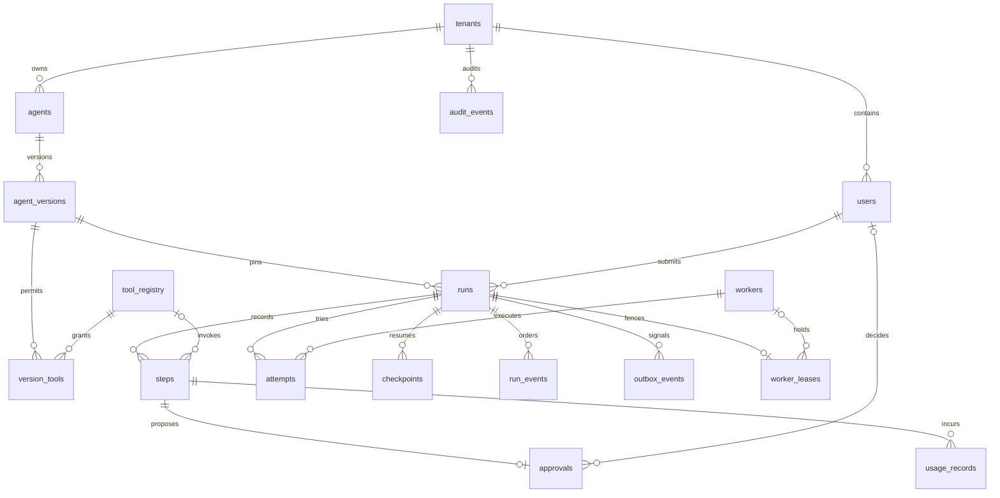

# PostgreSQL data model

All primary keys are UUIDs. Tenant-owned rows carry a non-null `tenant_id` FK. For tenant-owned parents, define `UNIQUE (tenant_id, id)` and reference both columns in children. For step, attempt and checkpoint references in a run, extend that pattern with `run_id` to prevent cross-run references. Every row has `created_at timestamptz`; mutable rows also have `updated_at`. Use database time for ownership and deadlines, integer token counts and fixed-point decimal currency with an explicit currency code.

| Table | Purpose and principal fields | Constraints / access paths |
| --- | --- | --- |
| tenants | Tenant boundary, slug, concurrency and submission quotas, last admission time | Unique slug, positive quotas. Index last admission time and ID for scheduler. |
| users | Local membership for verified identity, issuer, subject, role, enabled | Unique (tenant, issuer, subject). One identity may belong to several tenants. |
| audit_events | Tenant-wide security history for registry edits, approval decisions, grants and administrative access. Stores actor identity, action, object ID, outcome and request ID. | Append only. Index (tenant, created_at, id) and request ID. Persist alongside successful changes, and record denied requests independently of rolled-back commands. |
| agents | Stable tenant-owned name and description | Unique (tenant, name). |
| agent_versions | Agent FK, version number, publication state, instructions, provider/model, limits JSONB | Unique (agent, number). Allocate under agent lock. Configuration is immutable after publication. |
| tool_registry | Tenant-owned immutable tool version, implementation key, name, version, input schema JSONB, risk, permission, timeout, byte limit, idempotency mode, enabled | Unique (tenant, name, version). Disable separately from immutable behavior. |
| version_tools | Grant from a particular agent version to a particular tool version | Unique (agent_version, tool_version). Freeze grants on publication. |
| runs | Version FK, submitter FK, key and normalized request hash, input/output JSONB, state, revision, priority, enqueue/due/deadline times, terminal reason | Unique (tenant, submission_key). Index (tenant, created_at, id) for listing, partial indexes on queued priority/enqueue time, due retries and nonterminal deadlines. |
| attempts | One claim of a run, attempt number, worker session FK, generation, started/ended times and reason | Unique (run, number) and (run, generation). Attempts can span several durable steps. |
| workers | Global worker boot/session identity, capacity, heartbeat, draining flag | Register a fresh UUID on restart. Index heartbeat. Expose tenant-filtered projections to clients. |
| worker_leases | Single reusable fence per run, owner session FK, generation, heartbeat, expires_at | Unique run. Index expiry and owner for recovery and capacity. Clear owner on release and retain generation. |
| steps | One logical action, ordinal, kind, status, tool version FK if applicable, validated input/result JSONB, stable operation key, dispatch status and request metadata | Unique (run, ordinal) and operation key. A retry reuses the row. Mark dispatch intent before I/O and complete under the current fence. |
| checkpoints | Versioned resume cursor, boundary kind, next ordinal, minimal continuation JSONB and event sequence | Unique (run, event_seq). Append only. Index (run, event_seq descending). |
| run_events | Ordered state, step and approval history, event kind, redacted payload, actor, trace ID | Unique (run, seq). Allocate monotonic sequence under run lock, including events within a single transition. |
| approvals | Step FK, canonical action digest, state, expiry, deciding member FK, decision time and reason | Unique step. Index (tenant, state, created_at). A pending proposal can resolve once. |
| outbox_events | Durable dispatch intent, run FK, message kind, available_at, publish claim token/expiry, publish attempts, published_at | Index (available_at, id) for unpublished rows. UUID is stable across publication retries. |
| usage_records | One provider invocation, step FK, invocation number, provider/model, reservation, actual input/output tokens, price snapshot, estimated cost, latency, request ID and outcome | Unique (step, invocation_number). Index (tenant, created_at). Retain uncertain reservations until reconciled. |

## Writes, isolation and retention

Run transitions, events, checkpoints, lease changes and dispatch intent share a transaction when they describe the same boundary. Transactions that change capacity acquire tenant, run and worker locks in that order. Acquiring a lease increments generation even on the same worker. Use restrictive foreign key deletion for history, published versions and audit records. An ordinary user cannot hard-delete these records.

Enforce row-level security on tenant-owned tables using transaction-local verified tenant context for both reads and writes. Use a non-owner API role without bypass privileges and force RLS on tenant tables. Global scheduler scans and outbox operations use a separate narrowly privileged service identity. Public queries cannot select the global worker table directly. [PostgreSQL row security](https://www.postgresql.org/docs/current/ddl-rowsecurity.html)

Alembic revisions create parent tables and unique keys before dependent FKs, then install indexes and RLS. Exercise migrations against PostgreSQL from an empty database and from the last released revision, including attempted cross-tenant and cross-run inserts. Start with retained history. Introduce pruning only with a documented replay window, submission-key retention contract and a verified backup.
