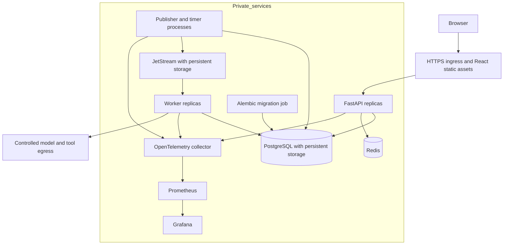

# Deployment design

Phase 1 supplies Compose services for the API, dashboard, PostgreSQL, Redis, JetStream and one migration job. A one-shot credentials job initializes passwords in separate named volumes. Only the dashboard gateway publishes a host port, bound to loopback. Database and stream files persist in named volumes. The publisher, timer and worker entry points arrive with their implementation phases. [Local command and environment reference](../operations/local-development.md)

Liveness checks prove the process can respond. Readiness verifies dependencies used by that service and the expected migration revision. The API can durably accept a submission during broker downtime while PostgreSQL and admission controls are healthy. Workers wait for database and consumer readiness before pulling. Migration runs once per rollout before new application instances become ready.

Production deployment adds TLS and workload credentials, separate database roles, limited egress, tested point-in-time database restore, resource limits, graceful drains and alerts on queue age, unpublished outbox age and expired leases. Ship stateless API and worker images separately from stateful backing services. Introduce Kubernetes after Compose recovery tests and backup restoration pass.

## Development environment inspected for Phase 0

The Windows workspace began as an empty Git repository on `main`. Git 2.56.0, Python 3.15.0, uv 0.12.24, Node 24.21.0, npm 11.19.0, Docker Engine 29.8.2 and Compose 5.6.0 responded to version checks. The standalone PostgreSQL, Redis and NATS CLIs were absent from PATH. Phase 1 should pin and test a supported Python 3.12+ runtime inside the build, independently of the host interpreter.
