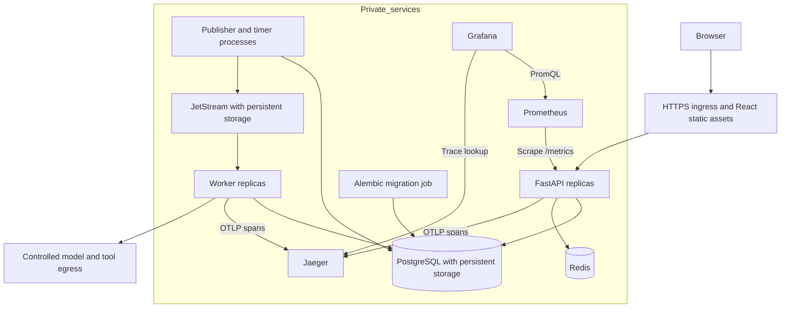

# Deployment design

Compose supplies the API, dashboard, PostgreSQL, Redis, JetStream, outbox publisher and scalable worker processes. One-shot jobs generate local credentials, provision database logins and run migrations. The base stack publishes the dashboard gateway on loopback. The observability overlay also publishes Grafana and Jaeger on loopback. PostgreSQL, JetStream and Prometheus data persist in named volumes. The worker maintenance loop reclaims expired leases and promotes due retries. [Local command and environment reference](../operations/local-development.md) · [Observability operations](../operations/observability.md)

Liveness checks prove the process can respond. Readiness verifies dependencies used by that service and the expected migration revision. The API can durably accept a submission during broker downtime while PostgreSQL and admission controls are healthy. Workers wait for database and consumer readiness before pulling. Migration runs once per rollout before new application instances become ready.

The production Compose overlay terminates TLS at a non-root gateway, runs application images with read-only roots and dropped capabilities, and keeps stateful services on an internal network. The API defaults to three processes with four PostgreSQL connections each. Budget database connections for every API and worker replica. The private Prometheus instance routes alerts through the configured Alertmanager receiver. The deployment drill restores a physical backup into new volumes, replays WAL and verifies the interrupted run through HTTPS. [Deployment and recovery runbook](../operations/production.md)

## Development environment inspected for Phase 0

The Windows workspace began as an empty Git repository on `main`. Git 2.56.0, Python 3.15.0, uv 0.12.24, Node 24.21.0, npm 11.19.0, Docker Engine 29.8.2 and Compose 5.6.0 responded to version checks. The standalone PostgreSQL, Redis and NATS CLIs were absent from PATH. Phase 1 should pin and test a supported Python 3.12+ runtime inside the build, independently of the host interpreter.
