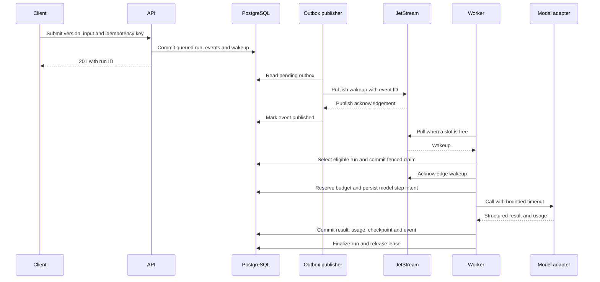

# Execution lifecycle

## Transition contract

| From | To | Required condition |
| --- | --- | --- |
| CREATED | QUEUED | Submission transaction pins a published version and records the initial wakeup. Both creation and queueing are visible in the timeline. |
| QUEUED | RUNNING | Scheduler finds capacity and atomically creates a new lease generation and attempt. |
| RUNNING | SUCCEEDED | Final result persisted under the current lease. |
| RUNNING | FAILED | Permanent error, exhausted retry budget or unresolved external effect. Persist a reason code. |
| RUNNING | WAITING_FOR_APPROVAL | Persist pending proposal and checkpoint and release capacity in one commit. |
| WAITING_FOR_APPROVAL | QUEUED / FAILED | Approval persists the decision and resume checkpoint and enqueues. Rejection ends the run with reason `approval_rejected`. |
| RUNNING | RETRY_WAIT | Transient failure within attempt budget or expired lease recovered by the reaper. Set next eligible time and release capacity. |
| RETRY_WAIT | QUEUED | Timer reaches `available_at` and writes a new wakeup. |
| QUEUED / RUNNING / RETRY_WAIT / WAITING_FOR_APPROVAL | CANCEL_REQUESTED | Authorized caller requests cancellation and invalidates pending approvals. Stop admitting new operations. |
| CANCEL_REQUESTED | CANCELLED | Active owner acknowledges at a safe boundary, or control plane finalizes once no valid lease remains. |
| Any nonterminal state | TIMED_OUT | Database time reaches the absolute deadline. Invalidate lease and pending approval, release capacity. |

Terminal states are immutable. Every writer locks the run, rechecks the expected state/revision, tests the deadline with database time and commits state plus the next event sequence. A worker additionally locks and verifies the lease owner, generation and remaining validity. The timer can finalize an expired run without worker cooperation. Once an external request is in flight, cancellation or expiry cannot retract its remote effects. Preserve its operation identity for reconciliation.

## Fair dispatch and retries

A wakeup means the database may contain eligible work. It carries no authority to claim a particular run. Workers pull at most their available slots from a shared durable consumer. The scheduler serializes admission per tenant by locking one eligible tenant row ordered by oldest last admission, then tenant ID, skipping locked rows. It checks active leases against the tenant quota, locks a due queued run ordered by priority descending then enqueue time and ID, and locks the worker session to check its capacity. Use the same tenant → run → worker lock order for capacity changes. The claim transaction advances the tenant's last admission time and commits the lease, attempt and RUNNING transition together.

The worker acknowledges after a successful claim or a committed check finding no eligible work. A database error leaves the message available for redelivery. A bounded periodic scan emits replacement wakeups for eligible backlog even if a previous wakeup found full capacity or the stream lost an old message. Rate-limit scan output to available capacity. Fairness applies across eligible tenants. Within a tenant, sustained high priority traffic can delay lower priorities.

Use bounded exponential backoff with jitter for transient failures. Persist attempt count and due time, cap provider retry-after by remaining deadline, and avoid nested retry loops multiplying a run's budget. Validate step count, token reservation and estimated spend before every model call. If a run has a monetary limit, require a known price and reserve a worst-case cost before dispatch. Account conservatively for unknown provider usage after a timeout.
