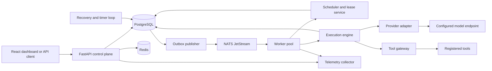

# Technical specification

AgentOS gives a tenant a durable record of each submitted task, the exact configuration used to execute it, and the actions it authorized. A run can outlive the API request, a worker process, a broker outage and a human approval delay. The first vertical slice will take a task from an immutable agent version to a persisted result using a deterministic provider.

The API and background processes share one Python domain package. The publisher, timer loop and workers have separate process lifetimes. The diagram shows logical calls, including calls within a process. The dashboard reads tenant-scoped API projections and follows the durable event cursor. [Component ownership](component-design.md) · [Deployment topology](deployment.md)

## Invariants

1. A committed submission pins a published version. The same tenant and submission key resolve to one run throughout its retention period.
2. Each durable transition updates run state, appends its ordered event and records any resulting dispatch intent in one transaction. PostgreSQL also owns quotas, leases and timers.
3. Each worker write verifies the current lease generation and expiration. Every external operation has a stable identity across attempts. A remote service can succeed during the gap before local persistence. [Execution guarantees](../adr/004-execution-guarantees.md)
4. A protected call requires a decision bound to the exact tenant, run, operation, tool version and validated arguments. Permissions are checked again at dispatch. [Approval workflow](approval-workflow.md)
5. Durable state has a replay path from a versioned checkpoint and subsequent committed records. Redis holds expiring counters and cache entries. [Checkpoint design](../adr/005-checkpoint-design.md)

## Scope and measurements

The MVP includes tenant roles, published agent and tool versions, bounded model/tool calls, cooperative cancellation, deadlines, recovery, approvals and a dashboard backed by real data. Interactive suspension initially occurs at approval boundaries. Arbitrary user pause/resume is a later API extension. Hosted code execution and browser automation require a separate isolation design. Initial deployment uses Docker Compose. Kubernetes follows a verified container deployment.

The initial investigation targets are p95 submission under 300 ms, normal dispatch under 2 s, and recovery within 30 s of lease expiry. The two-worker Phase 9 baseline met the submission target for sequential requests and the recovery target for all five injected faults. Dispatch exceeded its target in every measured cohort. [Measured latency, throughput and failure outcomes](../../benchmarks/results.md) · [Backlog](../backlog.md)
